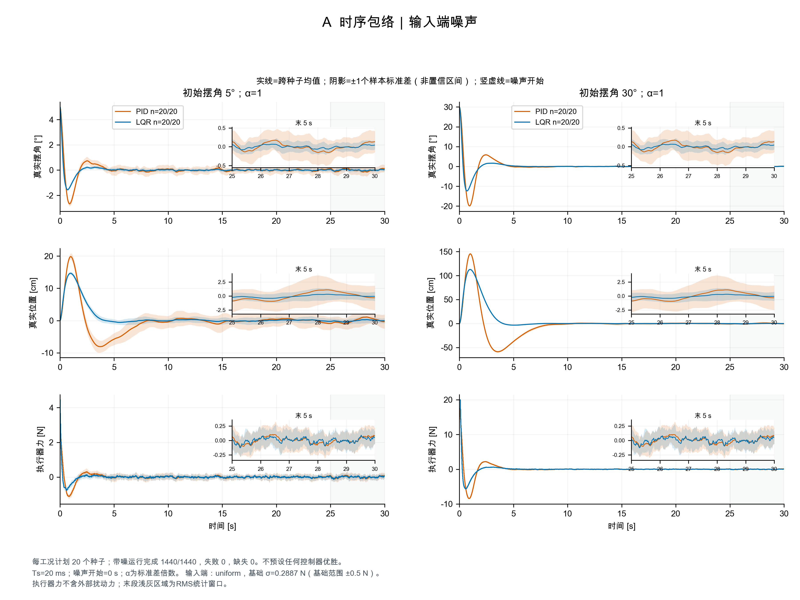
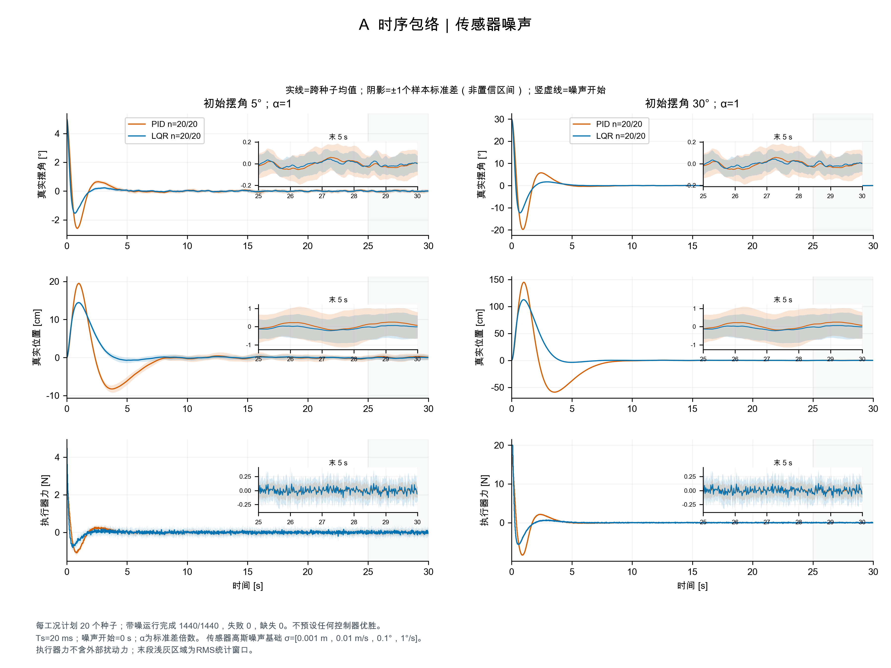
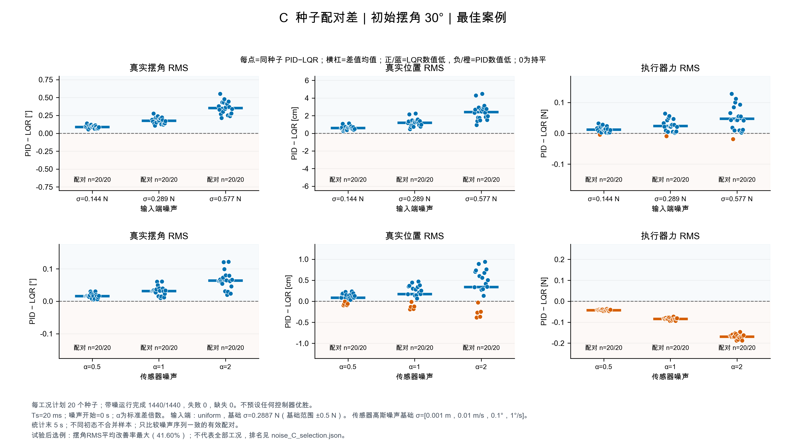

# 噪声鲁棒性实验结果（2026-11-02）

基于 GitHub main `ae4bd98d568786a303b7da33c373f8c5e4a83461`。原控制器、非线性动力学与积分器保持该版本；本目录随新增噪声实验代码归档。

## 实验范围

- 初始摆角5°、10°、15°、20°、25°、30°，其他状态为零。
- 每例30 s，反馈周期0.02 s，状态记录间隔0.01 s；噪声从t=0注入，统计末5 s（25–30 s）。
- 输入端噪声：零均值均匀随机外力，采样后保持，三档范围±0.25、±0.5、±1 N。外力加在执行器限幅之后。
- 传感器噪声：四状态独立高斯误差，基础标准差[0.001 m, 0.01 m/s, 0.1°, 1°/s]乘0.5、1、2。与输入噪声分别测试。
- 固定PID极点[-1,-1.2,-1.5,-2,-2.5]；LQR的Q=diag(10,1,100,1)、R=1；两者执行器均限幅±20 N，不按噪声工况重整定。
- M=m=1 kg、L=0.5 m、g=9.81 m/s²；同一原始连续非线性对象，DOP853及原配置求解精度。
- 每个带噪工况20个种子；同种子两方法共用完全相同的噪声。六初态复用序列，不作为额外独立样本池化。

## 完成与核验

正式批次共1452次（1440次带噪＋12次无噪基准），全部正常完成；726组PID/LQR配对噪声哈希一致。每次3001条状态记录、1500条控制记录。

全部轨迹在记录点满足|θ|<90°。这是30 s内保持预定直立区域的结果，不等价于严格无噪收敛容差或全局稳定性证明。模型没有轨道边界。最大能量平衡残差为1.47e-14 J。

19项协议测试通过；全部1452次原始CSV、噪声重建、测量与总力关系、限幅、记录数、主要指标及归档源码哈希核验通过。另以归档源码和配置重跑两例（5°传感器PID、30°输入LQR），三份CSV逐字节一致；这两次复核不计入1452次正式实验。

## 主要结果

下表给出各噪声类型下18个条件（6初态×3强度）的均值比较范围。降低比例=(PID均值−LQR均值)/PID均值；负值表示LQR更大。

| 噪声 | 指标 | LQR相对PID降低比例范围 | LQR均值更低的条件数 |
| --- | --- | --- | --- |
| 输入端 | 真实摆角RMS | 56.669%～56.681% | 18/18 |
| 输入端 | 真实位置RMS | 59.681%～59.685% | 18/18 |
| 输入端 | 执行器力RMS | 12.690%～12.707% | 18/18 |
| 传感器 | 真实摆角RMS | 26.524%～26.526% | 18/18 |
| 传感器 | 真实位置RMS | 22.008%～22.009% | 18/18 |
| 传感器 | 执行器力RMS | -64.013%～-64.011% | 0/18 |

在本组设定内，LQR对两类噪声的真实摆角和位置波动抑制更好。传感器噪声下，LQR的执行器力RMS更大；两类噪声下的力变化率也更高，体现了控制用力及平滑性的代价。不能写成所有指标都优于PID。均值比较不保证每个种子都更好。

12次无噪声基准均达到严格四状态末段容差；1440次带噪运行均未达到该无噪容差。持续随机波动与越出直立区域或发散应分开评价。

完整表还包含全程IAE、执行器平方积分、力变化率、最大行程、最大摆角、饱和占比，以及相对各自无噪基准的增量，避免将原本的恢复性能差异全部解释为抗噪性能。

## A＋C结果图

- A输入图：`figures/noise_A_input.png`及矢量PDF。
- A传感器图：`figures/noise_A_sensor.png`及矢量PDF。
- A均展示5°与30°、强度α=1，实线为20种子均值、阴影为±1样本标准差，附末5 s放大；阴影不是置信区间。
- C唯一选例：初始摆角30°，`figures/noise_C_30deg.png`及矢量PDF。

C按预先说明的选例规则：分别算每初态下六个噪声类型×强度条件的摆角RMS相对PID降低比例，再等权平均，取最大者；全部20配对必须完整，精确平手取较小角度。这是试验后选出的最佳案例，不作为整体代表或独立显著性证据。C仍同时保留位置和控制力列，包括LQR的代价；完整排名见`figures/noise_C_selection.json`。

| 初始摆角 | 六条件平均摆角RMS降低比例 |
| --- | --- |
| 5° | 41.59942093% |
| 10° | 41.59942103% |
| 15° | 41.59942113% |
| 20° | 41.59942124% |
| 25° | 41.59942133% |
| 30° | 41.59942141% |

六初态选例得分跨度仅0.00000048个百分点；选出的初态并不意味着与其他初态有实质性的末段抗噪差异。

### C所选30°、标准强度α=1的实际数值

| 噪声 | 指标 | PID均值±样本SD | LQR均值±样本SD | 相对PID降低比例 |
| --- | --- | --- | --- | --- |
| 输入端 | 真实摆角RMS [°] | 0.31265 ± 0.0679 | 0.13547 ± 0.0255 | 56.672% |
| 输入端 | 真实位置RMS [cm] | 2.0178 ± 0.601 | 0.81355 ± 0.261 | 59.681% |
| 输入端 | 执行器力RMS [N] | 0.18714 ± 0.0348 | 0.16339 ± 0.0173 | 12.693% |
| 传感器 | 真实摆角RMS [°] | 0.12056 ± 0.0312 | 0.088579 ± 0.0191 | 26.524% |
| 传感器 | 真实位置RMS [cm] | 0.77479 ± 0.308 | 0.60427 ± 0.244 | 22.008% |
| 传感器 | 执行器力RMS [N] | 0.13157 ± 0.00853 | 0.21579 ± 0.0091 | -64.013% |

## 全部摆角工况

每行20个配对种子。95%区间为固定条件内PID−LQR配对差的点态t区间，未作多重比较或试验后选例校正；其他指标和各方法样本标准差见`tables/condition_statistics.csv`。

| 噪声 | 初态 | α | PID摆角RMS均值[°] | LQR摆角RMS均值[°] | 降低比例 | 配对差95%区间[°] |
| --- | --- | --- | --- | --- | --- | --- |
| 输入端 | 5° | 0.5 | 0.156314 | 0.067732 | 56.669% | [0.078226, 0.098938] |
| 输入端 | 5° | 1 | 0.312648 | 0.135466 | 56.672% | [0.156465, 0.197900] |
| 输入端 | 5° | 2 | 0.625454 | 0.270940 | 56.681% | [0.313038, 0.395989] |
| 传感器 | 5° | 0.5 | 0.060277 | 0.044289 | 26.524% | [0.012730, 0.019246] |
| 传感器 | 5° | 1 | 0.120556 | 0.088579 | 26.524% | [0.025460, 0.038494] |
| 传感器 | 5° | 2 | 0.241121 | 0.177161 | 26.526% | [0.050925, 0.076996] |
| 输入端 | 10° | 0.5 | 0.156314 | 0.067732 | 56.669% | [0.078226, 0.098938] |
| 输入端 | 10° | 1 | 0.312648 | 0.135466 | 56.672% | [0.156465, 0.197900] |
| 输入端 | 10° | 2 | 0.625454 | 0.270940 | 56.681% | [0.313038, 0.395989] |
| 传感器 | 10° | 0.5 | 0.060277 | 0.044289 | 26.524% | [0.012730, 0.019246] |
| 传感器 | 10° | 1 | 0.120556 | 0.088579 | 26.524% | [0.025460, 0.038494] |
| 传感器 | 10° | 2 | 0.241121 | 0.177161 | 26.526% | [0.050925, 0.076996] |
| 输入端 | 15° | 0.5 | 0.156314 | 0.067732 | 56.669% | [0.078226, 0.098938] |
| 输入端 | 15° | 1 | 0.312648 | 0.135466 | 56.672% | [0.156465, 0.197900] |
| 输入端 | 15° | 2 | 0.625454 | 0.270940 | 56.681% | [0.313038, 0.395989] |
| 传感器 | 15° | 0.5 | 0.060277 | 0.044289 | 26.524% | [0.012730, 0.019246] |
| 传感器 | 15° | 1 | 0.120556 | 0.088579 | 26.524% | [0.025460, 0.038494] |
| 传感器 | 15° | 2 | 0.241121 | 0.177161 | 26.526% | [0.050925, 0.076996] |
| 输入端 | 20° | 0.5 | 0.156314 | 0.067732 | 56.669% | [0.078226, 0.098938] |
| 输入端 | 20° | 1 | 0.312648 | 0.135466 | 56.672% | [0.156465, 0.197900] |
| 输入端 | 20° | 2 | 0.625454 | 0.270940 | 56.681% | [0.313038, 0.395989] |
| 传感器 | 20° | 0.5 | 0.060277 | 0.044289 | 26.524% | [0.012730, 0.019246] |
| 传感器 | 20° | 1 | 0.120556 | 0.088579 | 26.524% | [0.025460, 0.038494] |
| 传感器 | 20° | 2 | 0.241121 | 0.177161 | 26.526% | [0.050925, 0.076996] |
| 输入端 | 25° | 0.5 | 0.156314 | 0.067732 | 56.669% | [0.078226, 0.098938] |
| 输入端 | 25° | 1 | 0.312648 | 0.135466 | 56.672% | [0.156465, 0.197900] |
| 输入端 | 25° | 2 | 0.625454 | 0.270940 | 56.681% | [0.313038, 0.395989] |
| 传感器 | 25° | 0.5 | 0.060277 | 0.044289 | 26.524% | [0.012730, 0.019246] |
| 传感器 | 25° | 1 | 0.120556 | 0.088579 | 26.524% | [0.025460, 0.038494] |
| 传感器 | 25° | 2 | 0.241121 | 0.177161 | 26.526% | [0.050925, 0.076996] |
| 输入端 | 30° | 0.5 | 0.156314 | 0.067732 | 56.669% | [0.078226, 0.098938] |
| 输入端 | 30° | 1 | 0.312648 | 0.135466 | 56.672% | [0.156465, 0.197900] |
| 输入端 | 30° | 2 | 0.625454 | 0.270940 | 56.681% | [0.313038, 0.395989] |
| 传感器 | 30° | 0.5 | 0.060277 | 0.044289 | 26.524% | [0.012730, 0.019246] |
| 传感器 | 30° | 1 | 0.120556 | 0.088579 | 26.524% | [0.025460, 0.038494] |
| 传感器 | 30° | 2 | 0.241121 | 0.177161 | 26.526% | [0.050925, 0.076996] |

## 文件与复现

- [仓库根目录](../../)：可运行噪声脚本、配置和测试。原有源码、PPT及课程PDF保持不变。
- `figures/`：只包含本批次A＋C图形、图形审计和C完整排名。
- `tables/summary.csv`：全部1452次逐运行指标；`condition_statistics.csv`：逐条件统计；`results_summary.json`：机器可读结论。
- `reproducibility/`：实际实验协议、增益、配置和代码快照、完整核验记录、测试和运行日志、两例复现核验。
- `raw_results/noise-experiments-20261102-full/runs/`：完整包独有的1452次原始记录。每例包含trajectory.csv、control.csv、noise_control.csv、metrics.json、metadata.json、run_config.json。
- [图表与代码小包ZIP](noise_results_figures_code_20261102.zip)约4.7 MB，保留原始交付快照；本目录亦展开图表、汇总及核验资料供直接查看。833 MB全量原始CSV压缩包未上传仓库，检查全量原始记录需要本地完整包。

`trajectory.csv`、`control.csv`的force_N为执行器力＋外部随机力；`noise_control.csv`明确分开执行器、外力与总力。控制用力与饱和指标只使用执行器力；状态误差指标只使用真实状态，不能拿带噪测量当真值。

在仓库根目录激活项目Python环境后，可重新跑完整实验（将创建新批次）：

```bash
python run_noise_experiments.py --run --workers 4 --plots AC
```

其他核验与重画命令见[项目README](../../README.md)。跨平台或依赖版本改变时不保证CSV逐字节相同，应结合求解精度比较。


## 图形预览






